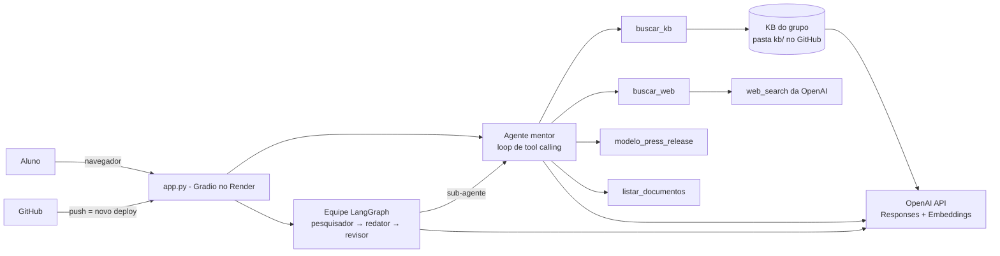

# Mentor de Negócios

Agente de IA que orienta cada grupo na criação do seu novo negócio, a partir da base de conhecimento (KB) do próprio grupo: o press release e demais documentos.

Projeto da aula **Agentes de IA, Function Calling e Orquestração** — Extensão Engenharia de Inteligência Artificial, FIA Labdata.

O agente:

- responde sobre o negócio consultando os documentos do grupo, sempre citando a fonte `[KB: ...]`;
- pesquisa contexto de mercado na internet, citando `[WEB: ...]`;
- escreve e revisa press releases com uma equipe de três especialistas (pesquisador, redator e revisor), com aprovação final do grupo (human-in-the-loop);
- executa trabalhos amplos, como um plano de negócio completo, em etapas (Plan-and-Execute).

## Arquitetura



## Estrutura do repositório

```
mentor-negocios/
├── app.py                  Interface web (abas Mentor, Press release, Plano de negócio, Base de conhecimento)
├── grupo.yaml              Parametrização do agente do grupo
├── kb/                     Documentos do grupo (persistidos pelo GitHub)
├── mentor/
│   ├── config.py           Lê grupo.yaml e variáveis de ambiente
│   ├── llm.py              Único ponto de contato com a OpenAI
│   ├── kb.py               Leitura, divisão em trechos, embeddings e busca
│   ├── tools.py            Ferramentas: schema + função + allowlist
│   ├── agente.py           Loop ReAct com tool calling e trace
│   ├── equipe.py           Multiagente em LangGraph
│   ├── plano.py            Plan-and-Execute para trabalhos amplos
│   ├── guardrails.py       Dados não confiáveis, limites de iteração e de tempo
│   ├── prompts.py          Todos os prompts
│   └── mcp_server.py       A KB exposta como servidor MCP
├── aula/                   Scripts de cada módulo da aula (m1 a m5)
├── evals/casos.yaml        Casos de avaliação do agente
├── exemplos/grupo1..3/     Press release e grupo.yaml de cada grupo da turma
├── tests/                  Testes sem rede (cliente OpenAI falso)
├── render.yaml             Blueprint de deploy no Render
├── requirements.txt        Dependências do app
└── requirements-aula.txt   Dependências extras dos scripts da aula
```

## Passo a passo de implementação

### 0. Pré-requisitos

- Python 3.12 e Git instalados.
- Conta no [GitHub](https://github.com) e no [Render](https://render.com) (o Render permite entrar com a conta do GitHub).
- Uma chave da OpenAI (`OPENAI_API_KEY`). Recomendação: crie um projeto na OpenAI para a turma, com limite de gasto mensal, e uma chave por grupo, para poder revogá-las ao fim do curso.

### 1. Criar o repositório do grupo

1. Abra o repositório da turma no GitHub e clique em **Use this template → Create a new repository** (ou faça um fork).
2. Dê um nome ao repositório, por exemplo `mentor-grupo2`, e clone-o:

```bash
git clone https://github.com/SEU_USUARIO/mentor-grupo2.git
cd mentor-grupo2
```

### 2. Parametrizar o agente do grupo

O agente é configurado por dois itens: o arquivo `grupo.yaml` e a pasta `kb/`.

1. Copie o material do seu grupo de `exemplos/`. Exemplo para o Grupo 3:

```bash
rm kb/*
cp exemplos/grupo3/*.md kb/
cp exemplos/grupo3/grupo.yaml grupo.yaml
```

2. Acrescente à pasta `kb/` os demais documentos do grupo: pesquisas, entrevistas, anotações, apresentações exportadas em PDF. São aceitos arquivos `.md`, `.txt` e `.pdf`. Em Markdown, use títulos (`##`): o agente divide os documentos por seção e cita o nome da seção.
3. Revise o `grupo.yaml`:

| Campo | Para que serve |
|---|---|
| `grupo`, `negocio` | Identificação exibida no app e usada no prompt do agente |
| `resumo`, `publico` | Contexto fixo que o agente recebe em toda conversa |
| `instrucoes_adicionais` | Orientações específicas do grupo para o agente |
| `agente.busca_web` | Liga ou desliga a pesquisa na internet |
| `agente.max_iteracoes`, `agente.timeout_segundos` | Guardrails contra loops: limite de passos e de tempo por resposta |
| `agente.max_revisoes` | Máximo de rodadas entre redator e revisor |

### 3. Rodar localmente

```bash
python -m venv .venv
source .venv/bin/activate          # Windows: .venv\Scripts\activate
pip install -r requirements-aula.txt
cp .env.example .env               # edite o .env e informe a OPENAI_API_KEY
python app.py
```

Abra http://localhost:7860.

### 4. Testar

```bash
pytest                             # testes sem rede e sem custo (cliente OpenAI falso)
python -m aula.m5_avaliacao        # avaliação real do agente (usa a API)
```

Adapte as perguntas de `evals/casos.yaml` ao negócio do grupo.

### 5. Publicar no GitHub

```bash
git status                         # confira que o .env NÃO aparece na lista
git add .
git commit -m "Parametriza o agente do grupo"
git push
```

### 6. Publicar no Render

1. No painel do Render, clique em **New → Blueprint** e selecione o repositório do grupo. O Render lê o `render.yaml`.
2. Quando for solicitado, informe a `OPENAI_API_KEY`. As demais variáveis já vêm preenchidas pelo blueprint.
3. Clique em **Apply** e aguarde o build (alguns minutos na primeira vez).
4. Acesse a URL `https://mentor-negocios-xxxx.onrender.com` exibida no painel.
5. Faça login com o usuário `grupo`. A senha foi gerada automaticamente e aparece em **Environment → APP_SENHA**.

O login protege a chave da OpenAI: sem ele, qualquer pessoa com o link consumiria os créditos do grupo.

**Se o serviço foi criado em New → Web Service (sem Blueprint):** o `render.yaml` não é lido. Use `pip install -r requirements.txt` como Build Command e `python app.py` como Start Command. Em **Environment**, cadastre `OPENAI_API_KEY`, `APP_USUARIO` e `APP_SENHA`. A versão do Python vem do arquivo `.python-version` (3.12).

### 7. Atualizar a base de conhecimento

A KB persistente é a pasta `kb/` do repositório. Para incluir ou alterar documentos:

```bash
cp ~/Downloads/entrevistas.pdf kb/
git add kb/ && git commit -m "Adiciona entrevistas à KB" && git push
```

O Render publica a nova versão automaticamente. A aba **Base de conhecimento** do app também aceita envio de arquivos, mas eles valem só para a sessão: o disco do plano gratuito do Render é apagado a cada reinício.

## Como usar o agente

**Aba Mentor.** Exemplos de pedidos:

- "Quais lacunas você vê no nosso press release?"
- "Simule cinco perguntas difíceis de um investidor e responda com base nos nossos documentos."
- "Quem são os concorrentes deste negócio no Brasil e como nos diferenciamos?"
- "Monte o FAQ para clientes do nosso produto."

O painel **Trace das ferramentas** mostra quais ferramentas o agente chamou, com quais argumentos e o que recebeu.

**Aba Press release.** Descreva o pedido; a equipe pesquisa, escreve e revisa até aprovar ou atingir o limite de rodadas. Leia o resultado e, se quiser, escreva seus ajustes e gere uma nova versão.

**Aba Plano de negócio.** Para trabalhos amplos (plano de negócio, análise de viabilidade, plano de go-to-market). O planejador divide o pedido em até 8 etapas e o agente executa uma por vez, cada uma com pesquisa e limite de passos próprios. O resultado tem sumário executivo e pode ser baixado em Markdown para revisão e inclusão em `kb/`.

**Pedidos amplos na aba Mentor.** Se o agente atingir o limite de passos, ele consolida uma resposta com o que já coletou e lista as pendências. Peça uma pendência por vez ou use a aba Plano de negócio.

## Scripts da aula

| Script | Tema | Slides |
|---|---|---|
| `python -m aula.m1_tool_calling` | O ciclo de tool calling sem abstrações | 16–18 |
| `python -m aula.m2_workflow_vs_agente` | A mesma pergunta como workflow e como agente | 13–15 |
| `python -m aula.m3a_smolagents` | O mesmo agente com o framework smolagents | 21 |
| `python -m aula.m3b_mcp` | Host, client e server MCP com a KB do grupo | 20, 30 |
| `python -m aula.m4_equipe` | Equipe multiagente em LangGraph | 22, 31 |
| `python -m aula.m5_avaliacao` | Avaliação de seleção de ferramenta e de citação | 25, 32 |

## Guardrails implementados

| Risco (slide 26) | Mitigação no código |
|---|---|
| Prompt injection via ferramentas | Toda saída de ferramenta vai marcada como `<dados_nao_confiaveis>`, e o prompt instrui a não seguir ordens contidas ali (`guardrails.py`) |
| Runaway loops | Limite de iterações e de tempo por resposta; limite de rodadas de revisão na equipe |
| Excessive agency | Allowlist de ferramentas, todas somente de leitura; ferramenta desconhecida vira mensagem de erro (`tools.py`) |
| Vazamento de credenciais | Chave só em variável de ambiente; `.env` no `.gitignore`; login no app |
| Cascata de erros | Erros de ferramenta voltam ao LLM como texto, sem derrubar o agente; trace visível |
| Alucinação sobre o negócio | Citação obrigatória de fonte; o que não tem fonte é apresentado como sugestão |

## Custos e limites

- **OpenAI:** cobrança por uso. O modelo padrão (`gpt-6-luna`) é o de menor custo da linha atual; a busca na web tem custo adicional por chamada. Os preços estão em https://openai.com/api/pricing.
- **Render (plano gratuito):** o serviço adormece após 15 minutos sem acesso, e o primeiro acesso seguinte leva cerca de 1 minuto. São 750 horas por mês por workspace, e o disco é temporário.

Para trocar de modelo, altere `OPENAI_MODEL` no Render (Environment) ou no `.env`. Os modelos disponíveis estão em https://developers.openai.com/docs/models.

## Solução de problemas

| Sintoma | Causa provável |
|---|---|
| O app encerra com "Defina a variável de ambiente OPENAI_API_KEY" | A chave não foi informada no `.env` ou no painel do Render |
| Erro 401 da OpenAI | Chave inválida ou revogada |
| Erro de modelo inexistente | O valor de `OPENAI_MODEL` foi descontinuado; escolha outro na página de modelos |
| A página demora a abrir no Render | O serviço estava adormecido; aguarde cerca de 1 minuto |
| Arquivos enviados pela aba desapareceram | O serviço reiniciou; coloque-os em `kb/` e faça push |
| Resposta termina com o aviso de resposta consolidada | O pedido era amplo para uma única resposta; peça as pendências separadamente ou use a aba Plano de negócio |
| O script do MCP não encontra ferramentas | Rode a partir da raiz do projeto, com `requirements-aula.txt` instalado |

## Observação sobre a API

Os slides 16 a 18 mostram o schema de function calling no formato da Chat Completions API (`{"type": "function", "function": {...}}`). Este projeto usa a **Responses API**, pela qual os modelos atuais da OpenAI estão disponíveis. O conceito é o mesmo; muda o formato:

- o schema da ferramenta é plano: `{"type": "function", "name": ..., "parameters": ...}`;
- o resultado volta como item `function_call_output`, ligado à chamada pelo `call_id`.
